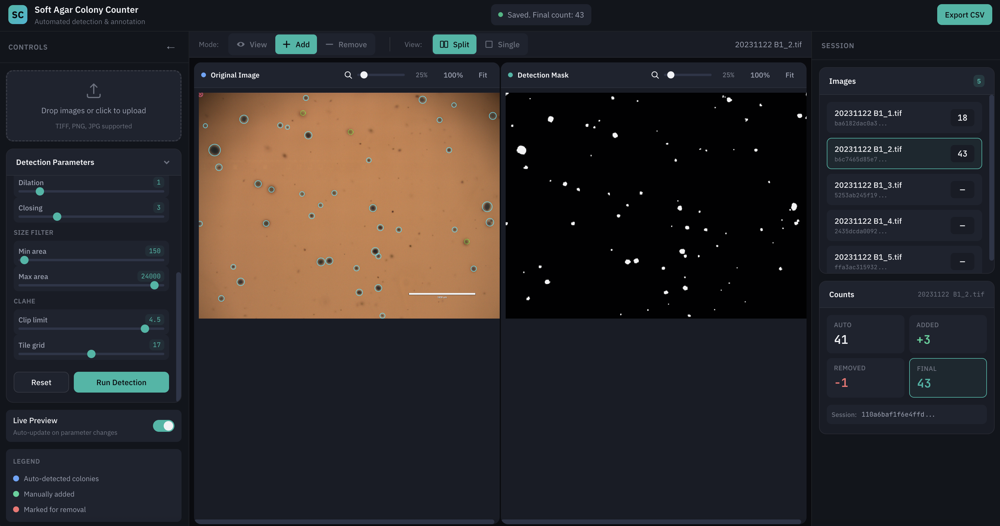

# SoftCount

Automated colony counting for soft agar assays. Upload your images, adjust detection parameters with live preview, manually add or remove colonies as needed, and export your counts to CSV.



---

## Citation

If you use SoftCount in a publication, please cite:

> Sarfaraz, N. (2026). *SoftCount* (Version 1.0.2) [Software].
> https://github.com/Nima-Sarfaraz/SoftCount

BibTeX:

```bibtex
@software{sarfaraz2025softagar,
  author  = {Sarfaraz, Nima},
  title   = {SoftCount},
  year    = {2026},
  version = {1.0.2},
  url     = {https://github.com/Nima-Sarfaraz/SoftCount}
}
```
---
## Installation Guide

Choose the method that works best for you. **Option 1 (Python Script)** is recommended for most users.

### Option 1: Python Script (Recommended)

This method uses a simple script that sets everything up automatically.

#### Step 1: Install Python

You need Python 3.10 or newer. SoftCount is tested on Python 3.10 through 3.15.

<details>
<summary><strong>macOS</strong></summary>

1. Open **Terminal** (press `Cmd + Space`, type "Terminal", press Enter)
2. Check which Python you have by typing: `python3 --version`
3. If it shows Python 3.10 or newer, you're all set. Otherwise (it shows 3.9 or older, says the command is not found, or a pop-up asks to install developer tools, which you can cancel), download Python from [python.org/downloads](https://www.python.org/downloads/) and run the installer
4. After installing, close Terminal and open a new Terminal window so it finds the new Python

</details>

<details>
<summary><strong>Windows</strong></summary>

1. Go to [python.org/downloads](https://www.python.org/downloads/) and click the download button
2. Run the file you downloaded:
   - **Python install manager** (the default download for Python 3.14 and newer): click **Install**. Then open Command Prompt (press `Win + R`, type `cmd`, press Enter), run `py install default`, and answer `y` to any questions it asks
   - **Traditional installer** (Python 3.13 and older): **check the box that says "Add python.exe to PATH"** at the bottom of the first screen, then click **Install Now**
3. To check that it worked, open a new Command Prompt and type `python --version`. It should show Python 3.10 or newer

</details>

<details>
<summary><strong>Linux (Ubuntu/Debian)</strong></summary>

Open a terminal and run:
```bash
sudo apt update
sudo apt install python3 python3-pip python3-venv
python3 --version
```
The last command should show Python 3.10 or newer (Ubuntu 22.04+ and Debian 12+ include a new enough version).

</details>

#### Step 2: Download the Software

**Option A: Download ZIP (easiest)**
1. Click the green **Code** button at the top of this page
2. Click **Download ZIP**
3. Extract the ZIP file to a folder (e.g., your Desktop or Documents). On Windows, right-click the ZIP and choose **Extract All**. The app won't run from inside the ZIP

**Option B: Using Git (if you have it installed)**
```bash
git clone https://github.com/Nima-Sarfaraz/SoftCount.git
```

#### Step 3: Run the Application

<details>
<summary><strong>macOS / Linux</strong></summary>

1. Open **Terminal**
2. Go to the folder where you extracted the files. Type `cd ` (with a space after it), drag the folder from Finder into the Terminal window, and press Enter. Or type the path yourself:
   ```bash
   cd ~/Desktop/SoftCount-master
   ```
   > **Note:** The folder may be named `SoftCount-master` or `SoftCount` depending on how you downloaded it.
3. Run the application:
   ```bash
   bash start.sh
   ```
4. The first run takes a few minutes while it installs everything. Then your browser opens to the app

</details>

<details>
<summary><strong>Windows</strong></summary>

1. Open the folder where you extracted the files
2. Double-click **`start.bat`**
3. If Windows warns you about running the file, click **Run** (or **More info**, then **Run anyway**)
4. A command window opens and sets things up. The first run takes a few minutes while it installs everything. Then your browser opens to the app

**Alternative:** If double-clicking doesn't work, open the folder in File Explorer, click the address bar at the top, type `cmd`, and press Enter. In the command window that opens, run `start.bat`. This keeps the window open so you can read any error messages.

</details>

The script automatically:
- Creates an isolated Python environment
- Installs all dependencies
- Starts the server
- Opens your web browser to the app (if it doesn't, go to the address shown in the terminal/command window, usually http://localhost:8000)

Keep the terminal/command window open while you use SoftCount. **To stop the application,** press `Ctrl + C` in that window or close it. To start it again later, run the script the same way. It starts much faster after the first time.

---

### Option 2: Docker (Alternative)

Docker is a containerization platform that packages the app with all its dependencies. This is useful if you're familiar with Docker or want complete isolation.

1. Download and install [Docker Desktop](https://www.docker.com/products/docker-desktop/), then start it and wait for it to fully load
2. Download and extract SoftCount as described in [Step 2](#step-2-download-the-software) above
3. Open a terminal in the SoftCount folder (Terminal on macOS/Linux, Command Prompt on Windows; see [Step 3](#step-3-run-the-application) for how to get there) and run:
   ```bash
   docker compose up
   ```
   The first time, this builds the app, which takes a few minutes.
4. Open http://localhost:8000 in your browser

**To stop:** Press `Ctrl + C` in the terminal.

---

## How to Use

Once the application is running in your browser:

1. **Upload Images** — Drag and drop your TIFF, PNG, or JPG files (8-bit or 16-bit) into the upload area on the left, or click it to browse
2. **Adjust Parameters** — Use the sliders under **Detection Parameters** to tune detection sensitivity. With **Live Preview** on, results update as you move them. Otherwise, click **Run Detection**. **Reset** returns the sliders to their defaults
3. **Review & Edit** — Choose **View**, **Add**, or **Remove** mode above the image, then click on the original image (the left pane in split view) to add a missed colony or remove a false one. Counts update in the panel on the right
4. **Move Between Files** — Click another image in the **Session** list on the right
5. **Export Results** — When you've finished all your images, click **Export CSV** at the top right to download a spreadsheet with one row per image: the final count, the automatic count, the number of colonies you added and removed, and the detection settings used

> **Note:** Your work is kept only while the app is open. Refreshing the page or stopping the app clears it, so export your CSV before you close it.

**Tips:**
- **Split** view (the default) shows your image and the detection mask side-by-side. **Single** view shows just the image
- The mask shows what the algorithm "sees" — white regions are potential colonies
- Each image remembers its own parameters, so you can tune each one individually. An image you haven't adjusted yet starts with the settings currently shown

---

## Features

- **Web UI:** Browser-based interface with drag-and-drop upload, live parameter tuning, and manual annotation
- **CLI:** Batch processing for automated workflows (see [CONTRIBUTING.md](CONTRIBUTING.md) for CLI usage)
- **FastAPI Backend:** REST API for programmatic access

---

## Example Data

`examples/data/` contains sample HepG2 and Huh7 plate images for testing and demos.
See `examples/README.md` for tutorials.

---

## Security & Privacy

This application runs entirely on your local machine — your images are never uploaded to external servers.

### Built-in Protections

- **Local-only**: The server only accepts connections from your own computer (`127.0.0.1`), not from other computers on your network
- **Temporary storage**: Uploaded images are kept on your computer only while the app is running and are deleted the next time it starts
- **Pre-built frontend**: No need to run `npm install` — we include the compiled files
- **Locked dependencies**: All packages pinned to exact, verified versions
- **Isolated environment**: Python runs in its own virtual environment

---

## Troubleshooting

**"Python is not installed" or "Python 3.10+ required":**
- Install Python as described in [Step 1](#step-1-install-python), then open a **new** terminal or command window and try again
- On Windows, if typing `python` opens the Microsoft Store, Python isn't installed yet (or wasn't added to PATH). Install it from python.org as described in Step 1

**Python dependency issues:**

SoftCount is tested on Python 3.10 through 3.15.

On macOS/Linux:
```bash
# Clean reinstall
rm -rf .venv
python3 -m venv .venv
source .venv/bin/activate
pip install -e ".[api]"
```

On Windows: delete the `.venv` folder inside the SoftCount folder, then run `start.bat` again.

**Port already in use:**

The start scripts automatically switch to the next free port (8001, 8002, ...) if port 8000 is busy, so use the address shown in the terminal/command window. With Docker, stop whatever is using port 8000:

On macOS/Linux:
```bash
lsof -i :8000
kill <PID>
```

On Windows:
```
netstat -ano | findstr :8000
taskkill /PID <PID> /F
```
(`<PID>` is the number in the last column of the `netstat` output.)

**Docker build fails:**
- Ensure Docker Desktop is running
- Try `docker compose build --no-cache`

**Frontend not loading:**
- Check that `frontend/dist/` exists
- Try stopping and re-running `start.sh` or `start.bat`

**Still stuck?** [Open an issue](https://github.com/Nima-Sarfaraz/SoftCount/issues) and include your operating system, Python version, and the text shown in the terminal/command window.

---

## Contributing

Want to contribute or use the CLI? See [CONTRIBUTING.md](CONTRIBUTING.md) for:
- Development setup
- Architecture overview
- CLI usage
- API endpoints
- Coding standards

We welcome bug reports, feature requests, and pull requests!

---

## License

MIT License - see [LICENSE](LICENSE) for details.
